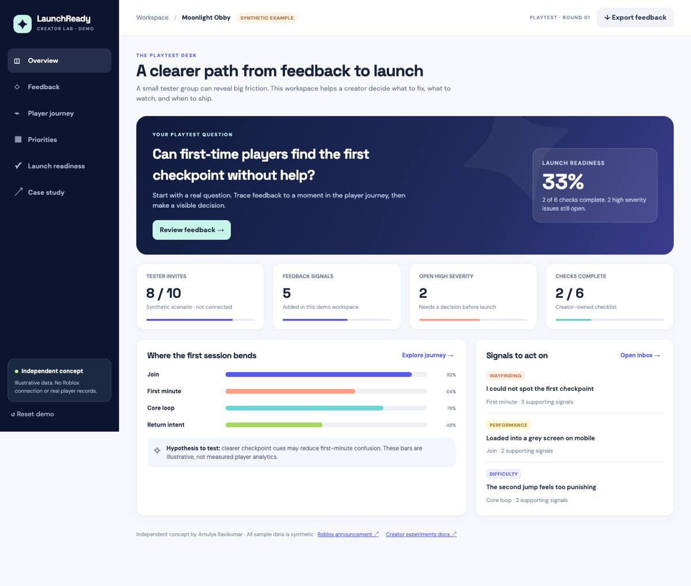

# LaunchReady

### From first playtest to confident launch

**An independent Roblox creator-focused PM case study and working prototype by Amulya Ravikumar**



## The 60-second case study

Roblox [announced early tester invitations](https://devforum.roblox.com/t/a-simpler-path-to-publish-plus-invite-early-testers/4930524) for eligible creators in October 2026. That made me curious about the next decision: **after a first playtest, how does a new creator decide what to fix and whether to launch?**

LaunchReady explores a simple workflow for that moment. A creator sets one learning question, captures feedback by player journey stage, groups recurring issues, compares possible fixes, and records a launch decision. It is a proposed complement to Roblox's existing creator tools, not a claim that those tools are missing.

| PM decision | My approach |
| --- | --- |
| **Who to help first** | A first-time solo or small-team creator reviewing a small private playtest. This audience is a hypothesis to validate, not a researched persona. |
| **What to build** | A guided question → feedback → themes → priority → readiness flow. I deferred AI clustering and platform integrations until real creator research supports them. |
| **How to know it helps** | Test whether creators can document a justified next action after a playtest; watch creator effort, safety steps, and unresolved critical issues as guardrails. |
| **What I made** | A responsive, stateful web prototype, a detailed PM case study, a four-slide summary, and browser tests. |

The prototype uses **synthetic demo data**. I have not conducted creator interviews, run an experiment, or measured impact. LaunchReady is independent and is **not affiliated with Roblox**.

**Explore the work:** [Full PM case study](CASE_STUDY.md) · [Four-slide deck](deck/LaunchReady_4_slide_case_study.pptx) · [Prototype files](dist/) · [Feedback view](screenshots/feedback-desktop.jpg) · [Mobile view](screenshots/overview-mobile.jpg)

## What you can try in the prototype

- Set a specific playtest question during onboarding.
- Add, search, filter, and triage feedback by player moment, theme, severity, and status.
- Compare candidate fixes with editable, illustrative RICE-style inputs.
- Review a launch checklist and unresolved high-severity issues.
- Export notes to CSV, retain changes in browser local storage, and reset the demo.

GitHub displays the prototype's source files. To interact with it, download or clone this repository, then run from the `launchready` folder:

```sh
python3 -m http.server 8765 -d dist
```

Open `http://localhost:8765/` for the dashboard or `http://localhost:8765/case-study.html` for the designed portfolio page. The app has no runtime dependencies.

## Test

The browser smoke test covers onboarding, feedback intake and search, readiness, priority editing, persistence, mobile layout, and the portfolio page. Start the local server in another terminal, then run:

```sh
npm install
npx playwright install chromium
npm run test:smoke
```

You can set `CHROME_PATH` to use a local Chrome binary or `LAUNCHREADY_URL` to test another URL. Test screenshots go to `test-output/` by default.

## Research boundary

The [full case study](CASE_STUDY.md) separates Roblox documentation and public signals from assumptions, then details user stories, MVP scope, prioritization, opportunity sizing without invented platform numbers, metrics, an experiment design with sample-size caveats, safety/privacy, and a go-to-market plan. Roblox's [analytics](https://create.roblox.com/docs/production/analytics) and [experiment documentation](https://create.roblox.com/docs/production/experiments) informed the proposed measurements. Every example note, count, and funnel value in the prototype is synthetic.

